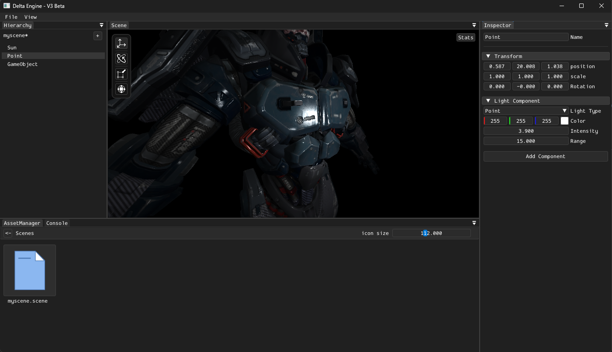
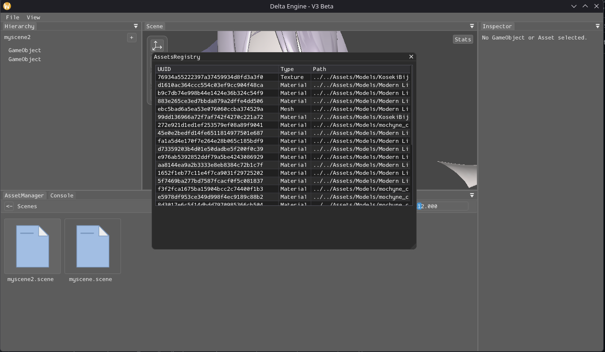

# GameEngine

<p>
  
  
  
</p>

A minimal game engine and real-time renderer built with OpenGL 4.5, with an integrated scene editor.



## Features

**Core**
- Hierarchical game objects with components
- Scene save and load using JSON `.scene` files
- Asset registry for mesh, material, and texture metadata

**Rendering**
- Clustered forward lighting with point and directional lights
- Lit and unlit shaders with diffuse, specular, and normal maps
- Model import through [Assimp](https://github.com/assimp/assimp)

**Editor**
- Scene view with translate, rotate, and scale gizmos
- Hierarchy and Inspector panels
- Asset browser, asset registry, and console panels

## Getting Started

### Requirements

- A GPU and driver with OpenGL 4.5 support
- CMake 3.21 or newer
- Ninja
- clang is used. you change it from ``CMakePresets.json`` to Clang/MSVC/GCC 
- Git

The included configure presets use Clang and Ninja. The project also needs the platform's OpenGL development libraries.

### Build

```bash
git clone https://github.com/ItzFalco08/gameengine.git
cd gameengine

cmake --preset clang-ninja-release
cmake --build build/release --target engine
```

For a debug build, use the `clang-ninja-debug` preset and `build/debug` directory. Toolchain settings are in [`CMakePresets.json`](./CMakePresets.json).

### Run

Run the executable from its build directory so the engine's relative asset paths resolve to the project root:

```bash
cd build/release

# Linux and macOS
./engine

# Windows PowerShell
.\engine.exe
```

## Screenshots

| Editor | Assets Registry |
| :---: | :---: |
|  |  |

## Project Structure

```text
gameengine/
|-- Assets/                 # Scenes and imported project assets
|-- screenshots/
|-- src/
|   |-- core/                # Scene, game object, renderer, and asset systems
|   |   |-- assets/
|   |   |   |-- meta/
|   |   |   `-- runtime/
|   |   `-- components/
|   |-- editor/
|   |   |-- gui/             # Editor panels
|   |   `-- resources/       # Editor icons
|   |-- shaders/
|   `-- utils/
|-- third_party/             # Vendored dependencies
|-- CMakeLists.txt
|-- CMakePresets.json
`-- README.md
```

## Roadmap

- [x] `Custom Engine Assets`
- [x] `Forward+ Rendering Pipeline`
- [ ] `PBR Shading`
- [ ] `Asset Editing`
- [ ] `Entity Selection from Scene View`
- [ ] `Scripting and Play Mode`
- [ ] `Exporting`
- [ ] `Engine Hub and Project Manager`

## Contributing

Contributions are welcome at every experience level, including bug reports, documentation fixes, and small first-time pull requests.

1. Fork the repository and create a feature branch.
2. Make your changes and make sure the project builds.
3. Open a pull request describing what you changed and why.

For questions or to discuss ideas before starting, you can reach me on Discord: `melodyy_fr`.

## Acknowledgments

- [Assimp](https://github.com/assimp/assimp)
- [SDL](https://github.com/libsdl-org/SDL)
- [Dear ImGui](https://github.com/ocornut/imgui)
- [ImGuizmo](https://github.com/CedricGuillemet/ImGuizmo)
- [GLM](https://github.com/g-truc/glm)
- [GLAD](https://github.com/Dav1dde/glad)
- [nlohmann/json](https://github.com/nlohmann/json)
- [stb](https://github.com/nothings/stb)
